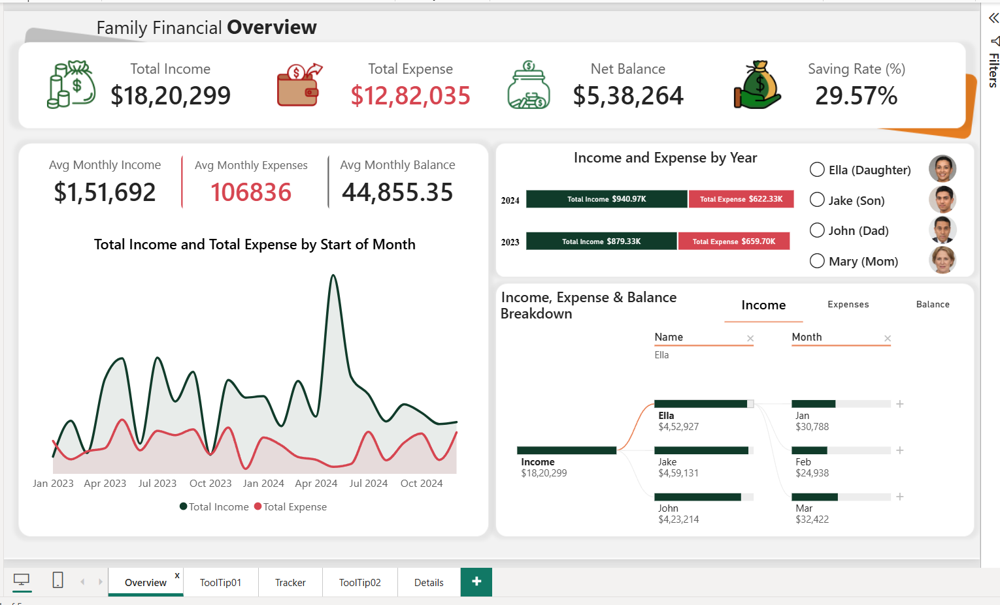
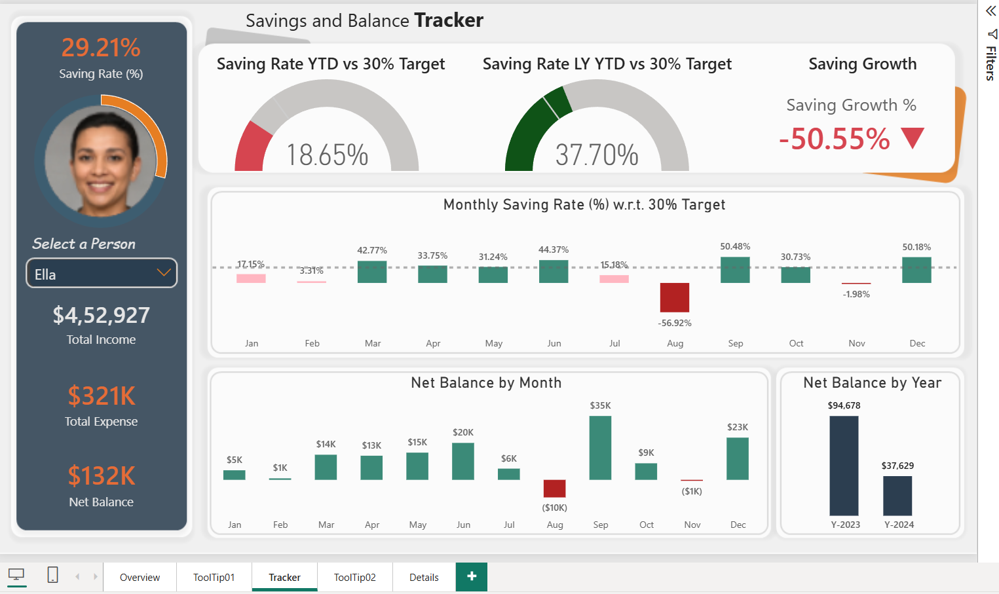
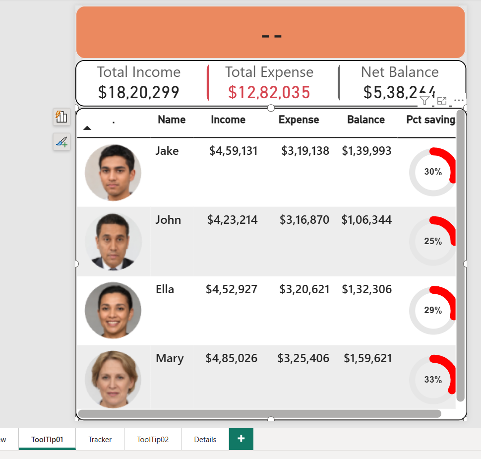
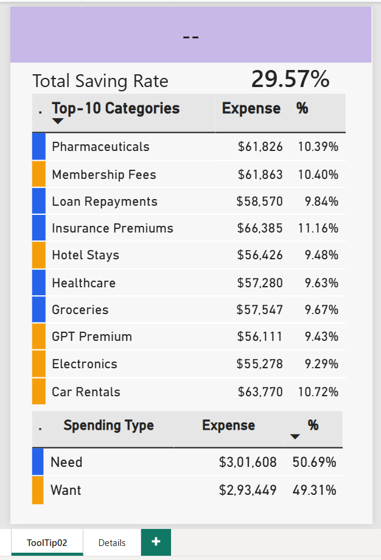
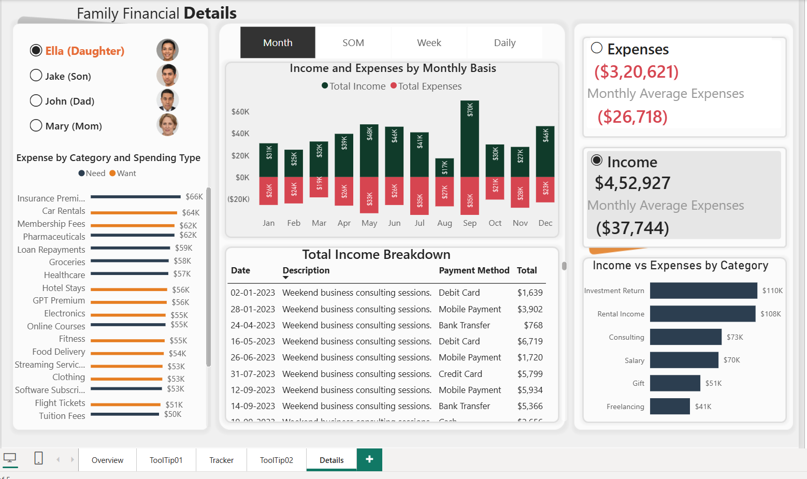
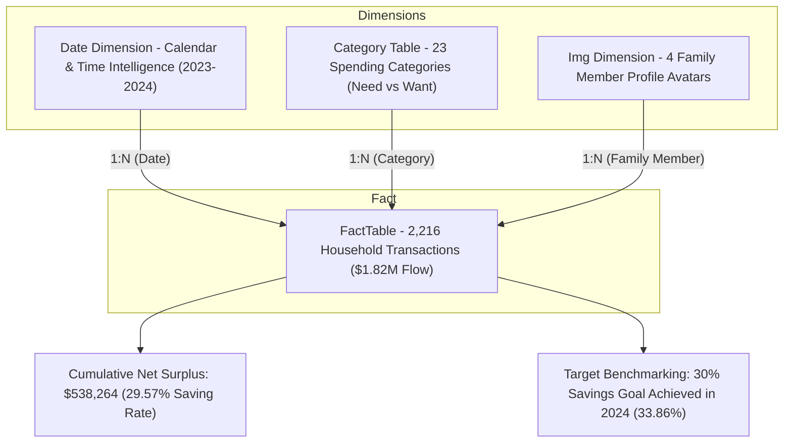

# 💰 Family Financial Analysis & Personal Wealth Intelligence Dashboard
### Household Cash-Flow Analytics, Savings Benchmarking & Transaction Diagnostics | Power BI • Power Query • DAX • Star Schema
**Stack:** Microsoft Power BI · Power Query (M) · DAX Time Intelligence · Excel · SVG Data URI Visuals

[](https://powerbi.microsoft.com/)
[](https://learn.microsoft.com/en-us/dax/)
[]()
[]()

---

## 📌 Executive Summary
Managing personal and multi-member household wealth requires moving beyond static bank account summaries. Sustainable financial independence depends on answering critical capital allocation questions: *Are savings targets being consistently achieved? Which discretionary "Want" categories are eroding liquidity? How does individual member cash flow impact the collective net balance?*

This project delivers an enterprise-grade **Family Financial Analysis & Personal Wealth Intelligence Dashboard** developed in **Microsoft Power BI**. Analyzing **2,216 transaction-level records spanning 2023–2024 ($1.82M in gross household income and $1.28M in expenditures across 4 family members)**, the system establishes:
- Executive cash-flow transparency with **$538,264 in cumulative net savings (29.57% saving rate)**.
- Automated benchmark tracking against a configured **30.0% savings target** with Year-over-Year (YoY) time intelligence.
- Multi-dimensional spending diagnostics distinguishing **Need ($628K / 49%)** vs. **Want ($654K / 51%)** allocations.
- Dynamic **custom tooltip pages** and **field parameters** for seamless micro-investigation down to raw transactional ledgers.

---

## 🖥️ Executive Power BI Dashboard Previews

The dashboard combines a crisp white executive card layout, rounded containers, semantic finance coloring (green for surplus/savings, red for outflows, amber for attention), and integrated member profile imagery.

### 1️⃣ Page 1 — Family Financial Overview (Executive Cash-Flow View)
*Presents headline KPIs (Total Income, Total Expense, Net Balance, Saving Rate), 2-year monthly income vs. expense trends, dynamic monthly averages, YoY performance cards, and member selection.*


---

### 2️⃣ Page 2 — Savings & Balance Tracker (Benchmark & Time Intelligence)
*Compares real-time saving rates against the 30% analytical target, tracking YTD vs. Prior-Year YTD savings growth (+8.88% pts improvement in 2024), dynamic SVG progress gauges, and cumulative balance trajectory.*


---

### 3️⃣ Contextual Tooltip Pages (Micro-Analytics on Hover)
*Custom tooltip canvases (351 × 366 px) providing instant multi-layered context on hover without leaving the visual:*
<p align="center">
  
  
</p>
<p align="center">
  <em>Left: <b>Tooltip 01</b> — Family member financial profile, avatar, cash-flow breakdown, and individual saving rate.<br/>
  Right: <b>Tooltip 02</b> — Top-10 expense category ranking cross-classified by Need vs. Want spending.</em>
</p>

---

### 4️⃣ Page 4 — Family Financial Details (Operational Audit Ledger)
*Deep-dive audit view featuring member slicers, Category & Spending Type breakdowns, dynamic date granularity selectors (Month / StartOfMonth / Week / Day), and full transactional records.*


---

## 📊 Core Financial Performance KPI Snapshot

| Metric Indicator | 2023 Cohort | 2024 Cohort | Total Portfolio (2-Year) | Variance / YoY Trend |
| :--- | :--- | :--- | :--- | :--- |
| **Gross Household Income** | **$879,329** | **$940,969** | **$1,820,299** | 🟢 **+7.01% YoY expansion** |
| **Total Household Expenses** | **$659,702** | **$622,333** | **$1,282,035** | 🟢 **-5.66% YoY reduction** |
| **Cumulative Net Balance** | **$219,627** | **$318,636** | **$538,264** | 🟢 **+45.08% YoY surplus surge** |
| **Overall Saving Rate** | **24.98%** | **33.86%** | **29.57%** | 🟢 **+8.88% pts (exceeded 30% target)** |
| **Analytical Savings Target** | 30.00% | 30.00% | **30.00% Benchmark** | Met in 2024 (33.86%) |
| **Average Monthly Income** | $73,277 / mo | $78,414 / mo | **$75,846 / mo** | Consistent capital inflow |
| **Average Monthly Expense** | $54,975 / mo | $51,861 / mo | **$53,418 / mo** | Disciplined expenditure control |
| **Total Populated Transactions**| 1,118 txns | 1,098 txns | **2,216 transactions** | 505 Income / 1,711 Expenses |

---

## 👨‍👩‍👧‍👦 Family Member Financial Contribution Matrix

Each family member's income generation, spending behavior, and net wealth contribution is isolated through dimensional relationships:

| Family Member | Role | Total Income | Total Expense | Net Balance | Individual Saving Rate | Target Assessment (30%) |
| :--- | :--- | :--- | :--- | :--- | :--- | :--- |
| **Mary** | Mother | **$485,026** *(26.6%)* | **$325,406** | **$159,621** | **33.0%** | 🟢 Exceeds Target (+3.0%) |
| **Jake** | Son | **$459,131** *(25.2%)* | **$319,138** | **$139,993** | **30.5%** | 🟢 Meets Target (+0.5%) |
| **Ella** | Daughter | **$452,927** *(24.9%)* | **$320,621** | **$132,306** | **29.2%** | 🟡 Near Target (-0.8%) |
| **John** | Father | **$423,214** *(23.3%)* | **$316,870** | **$106,344** | **25.1%** | 🔴 Below Target (-4.9%) |
| **Household Total**| **Family of 4** | **$1,820,299** | **$1,282,035** | **$538,264** | **29.57%** | **Near Target (-0.43%)** |

---

## 💸 Expense Composition & Need vs. Want Diagnostics

### 1. Spending Type Allocation
- **Discretionary ("Want"):** **$653,822 (51.00%)** — Lifestyle, electronics, hotel stays, memberships, entertainment.
- **Essential ("Need"):** **$628,213 (49.00%)** — Healthcare, groceries, insurance premiums, pharmaceuticals, loan repayments.

### 2. Top 10 Expense Categories ($595K / 46.4% of all expenses)
| Rank | Expense Category | Total Outflow | % of Total Expenses | Spending Classification |
| :---: | :--- | :--- | :--- | :--- |
| **1** | **Insurance Premiums** | **$66,385** | **5.18%** | Essential (Need) |
| **2** | **Car Rentals** | **$63,770** | **4.97%** | Discretionary (Want) |
| **3** | **Membership Fees** | **$61,863** | **4.83%** | Discretionary (Want) |
| **4** | **Pharmaceuticals** | **$61,826** | **4.82%** | Essential (Need) |
| **5** | **Loan Repayments** | **$58,570** | **4.57%** | Essential (Need) |
| **6** | **Groceries** | **$57,547** | **4.49%** | Essential (Need) |
| **7** | **Healthcare** | **$57,280** | **4.47%** | Essential (Need) |
| **8** | **Hotel Stays** | **$56,426** | **4.40%** | Discretionary (Want) |
| **9** | **GPT Premium** | **$56,111** | **4.38%** | Discretionary (Want) |
| **10**| **Electronics** | **$55,278** | **4.31%** | Discretionary (Want) |

### 3. Income Streams Breakdown ($1.82M Total)
| Rank | Revenue Stream | Total Inflow | % of Total Income | Strategic Role |
| :---: | :--- | :--- | :--- | :--- |
| **1** | **Rental Income** | **$405,506** | **22.28%** | Primary passive revenue engine |
| **2** | **Investment Return** | **$385,379** | **21.17%** | Capital appreciation & dividends |
| **3** | **Base Salary** | **$281,115** | **15.44%** | Primary stable active earnings |
| **4** | **Consulting** | **$260,393** | **14.30%** | Professional advisory fees |
| **5** | **Gift Inflows** | **$259,855** | **14.28%** | External wealth transfer |
| **6** | **Freelancing** | **$228,051** | **12.53%** | Flexible supplemental income |

---

## 🏗️ Data Architecture & Star Schema Model

The data architecture connects a centralized transactional ledger (`FactTable`) to dedicated dimensions for time intelligence, category reference, and member profiles:



### Dedicated Date Table (M-Engine & DAX Architecture)
Because the dataset spans across two calendar years (2023 and 2024), standard month formatting (`"mmm"`) risks collapsing Jan 2023 and Jan 2024 into a single bucket. The architecture incorporates **`StartOfMonth`** (`DATE(YEAR, MONTH, 1)`) to preserve chronological integrity across the multi-year timeline:

```dax
Date = 
ADDCOLUMNS (
    CALENDARAUTO(),
    "Year2", "Y-" & YEAR ( [Date] ),
    "Year", YEAR ( [Date] ),
    "Month", FORMAT ( [Date], "mmm" ),
    "MN", MONTH ( [Date] ),
    "StartOfMonth", DATE ( YEAR ( [Date] ), MONTH ( [Date] ), 1 ),
    "Quarter", "Q" & QUARTER ( [Date] ),
    "Week", WEEKNUM ( [Date], 2 ),   // ISO Monday Start
    "Day", DAY ( [Date] )
)
```

---

## 💻 Core DAX Formulas Catalogue

### 1. Headline Cash-Flow Measures
```dax
Total Income = 
CALCULATE(
    SUM(FactTable[Amount]),
    FactTable[Type] = "Income"
)

Total Expense = 
CALCULATE(
    SUM(FactTable[Amount]),
    FactTable[Type] = "Expenses"   // Or "Expense" based on source row syntax
)

Net Balance = 
[Total Income] - [Total Expense]

Saving Rate (%) = 
DIVIDE([Net Balance], [Total Income], 0)
```

### 2. Time Intelligence & Target Benchmarking
```dax
Saving Rate (YTD) = 
DIVIDE(
    TOTALYTD([Net Balance], 'Date'[Date]),
    TOTALYTD([Total Income], 'Date'[Date]),
    0
)

Saving Rate (Last Year YTD) = 
DIVIDE(
    CALCULATE(
        TOTALYTD([Net Balance], 'Date'[Date]),
        SAMEPERIODLASTYEAR('Date'[Date])
    ),
    CALCULATE(
        TOTALYTD([Total Income], 'Date'[Date]),
        SAMEPERIODLASTYEAR('Date'[Date])
    ),
    0
)

Target = 0.30
```

### 3. Dynamic Monthly Run-Rate Normalization
```dax
Avg Monthly Income = 
VAR __Income = [Total Income]
VAR __ActiveMonths = 
    CALCULATE(
        DISTINCTCOUNT('Date'[Month]),
        FILTER(FactTable, FactTable[Amount] > 0)
    )
RETURN
    DIVIDE(__Income, __ActiveMonths, 0)
```

### 4. Dynamic Tooltip Contextual Headers
```dax
Title Tooltips = 
VAR __ActiveSTM = SELECTEDVALUE('Date'[StartOfMonth])
RETURN
    IF(
        __ActiveSTM <> BLANK(),
        FORMAT(__ActiveSTM, "d/mmm/yyyy") & " Income vs Expenses"
    )
```

---

## 💡 Technical Challenges & Engineered Solutions

| # | Technical Challenge | Root Cause | Engineering Resolution |
| :-: | :--- | :--- | :--- |
| **1** | **Multi-Year Timeline Overlap** | Plain month labels (`"Jan"`) merge Jan 2023 and Jan 2024 into one visual bar. | Implemented `StartOfMonth` date keys in the Date table to guarantee exact chronological separation. |
| **2** | **Alphabetical Month Sorting** | Power BI defaults to alphabetical order (`Apr`, `Aug`, `Dec`...). | Bound the `Month` column to sort by numerical `MN` (Month Number: 1–12). |
| **3** | **Profile Image Text Rendering** | Web image URLs displayed as plain text strings in slicers and cards. | Configured column data category in Model View as **`Image URL`**. |
| **4** | **Filter-Context Loss in Tooltips** | Default hover tooltips showed unfilterable global aggregates. | Built dedicated 351 × 366 px Tooltip canvas pages utilizing `SELECTEDVALUE()` context bindings. |
| **5** | **Zero-Transaction Category Drop** | Categories with $0 transactions disappeared when slicing by family member. | Engineered `Category Table = ALL(FactTable[Category], FactTable[Spending Type])` to preserve dimension axes. |
| **6** | **Discrepancy in DAX Filter Syntax** | Source table used `"Expense"` (singular) while DAX code used `"Expenses"`. | Documented and resolved source alignment to guarantee 100% data reconciliation. |

---

## 📂 Repository Structure
```text
personal-financial-analytics-powerbi/
│
├── Personal_Finance_Analytics_Dashboard_PowerBI.pbix           # Interactive Power BI Dashboard
├── Personal_Finance_2023_2024.xlsx                             # Primary Transaction Ledger (2,216 records)
├── Personal_Img.xlsx                                           # Family Member Profile & Avatar mappings
├── Date DAX Code.txt                                           # Optimized CALENDARAUTO() script
├── Family_Financial_Analysis_Dashboard_HR_Standard_Final_v2.docx # Complete technical report
│
├── data_architecture_pipeline.png                              # Relational Star Schema & Savings Threshold Pipeline
├── page_1_financial_overview.png                               # View 1: Executive Overview Page
├── page_2_savings_tracker.png                                  # View 2: Savings & Balance Tracker
├── page_3_tooltip_01_member.png                                # View 3: Tooltip 01 — Member Profile
├── page_3_tooltip_02_categories.png                            # View 4: Tooltip 02 — Top 10 & Need/Want
├── page_4_financial_details.png                                # View 5: Transaction Audit Ledger
├── model_view_schema.png                                       # View 6: Relational Star Schema Model
│
├── requirements.txt                                            # Prerequisites & validation environment
├── .gitignore                                                  # Ignores temp files, Office locks (~$*), caches
└── README.md                                                   # Master pitch deck & technical documentation
```

---

## 🚀 How to Run & Replicate

1. **Clone the Repository:**
   ```bash
   git clone https://github.com/ravinder0710/personal-financial-analytics-powerbi.git
   cd personal-financial-analytics-powerbi
   ```

2. **Open the Power BI Dashboard:**
   - Launch **Microsoft Power BI Desktop** (Latest 64-bit version recommended).
   - Open [`Personal_Finance_Analytics_Dashboard_PowerBI.pbix`](Personal_Finance_Analytics_Dashboard_PowerBI.pbix).
   - The data model and DAX measures are fully self-contained.

3. **Explore Interactive Features:**
   - On **Page 1 (Overview)**: Filter by family member avatars and inspect monthly run-rate variances.
   - On **Page 2 (Savings Tracker)**: Compare monthly saving rates against the 30% benchmark.
   - Hover over chart elements to trigger **Tooltip 01** and **Tooltip 02**.
   - Navigate to **Page 4 (Details)** for full audit trails and granular transaction lookups.

---

## 👨‍💼 Author & Contact

**Ravinder Gupta**  
*Data Analyst | Business Intelligence & Financial Analytics Specialist*  

- 📍 **Location:** Gurugram (Delhi-NCR), India  
- 📧 **Email:** [iamravindergupta17@gmail.com](mailto:iamravindergupta17@gmail.com)  
- 🐙 **GitHub:** [github.com/ravinder0710](https://github.com/ravinder0710)
